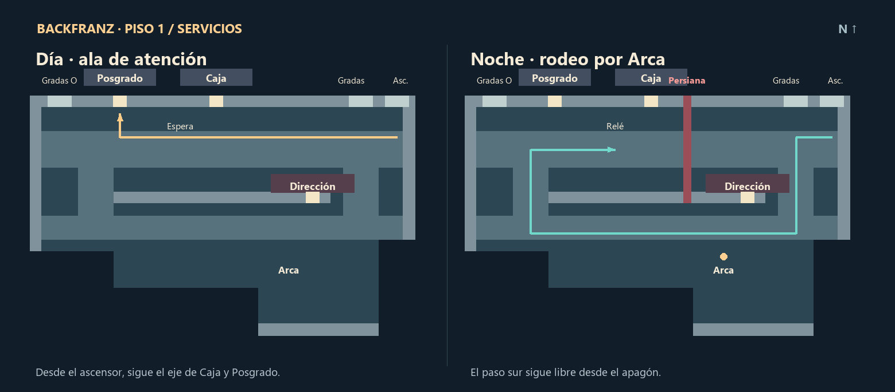

# Piso 1 · Servicios

El ascensor y las gradas centrales quedan en el extremo este. Caja y Posgrado abren hacia el corredor norte. Dirección de Carrera tiene entrada desde el pasillo inferior, donde también está el punto de atención de Arca. Los extremos del pasillo se conectan por dos cruces. Las gradas oeste quedan cerca de Posgrado.

| Ambiente | Planta de día | Variante nocturna |
|---|---|---|
| Posgrado | Mostrador al fondo, mesa de consulta sobre madera al oeste y archivo al este. El corredor central deja libre la entrada. | Se mantienen el testimonio de Samuel, el puente del relé e Inés. El acompañamiento de Inés lleva al refugio al este del pasillo inferior. |
| Caja | Tres ventanillas con filas de color. Pagos a la izquierda, Consultas al centro y Recibos a la derecha. El dispensador queda junto a la pared este. | El vidrio de Consultas queda iluminado. Iris conserva el registro de llaves. |
| Dirección de Carrera | Espera junto a los archivadores, mesa de entrevista en el centro y escritorio de atención al fondo. | Mónica puede indicar el rodeo si le devuelves la credencial perdida. Su testimonio del apagón sigue disponible. |
| Arca | Punto de atención abierto al pasillo inferior. | La credencial se encuentra sobre el mostrador. |

Al bajar la persiana se corta el corredor norte. Para ir de la salida del ascensor a Posgrado o al cuadro de relés, baja por el cruce este, recorre el pasillo de Arca y sube por el oeste. Cerca del cuadro se oye la interferencia. El camino se puede recorrer desde el apagón. La credencial es opcional y al devolverla quedan visibles las marcas de Mónica. La mochila conserva la credencial hasta la entrega y el guardado conserva las marcas.
