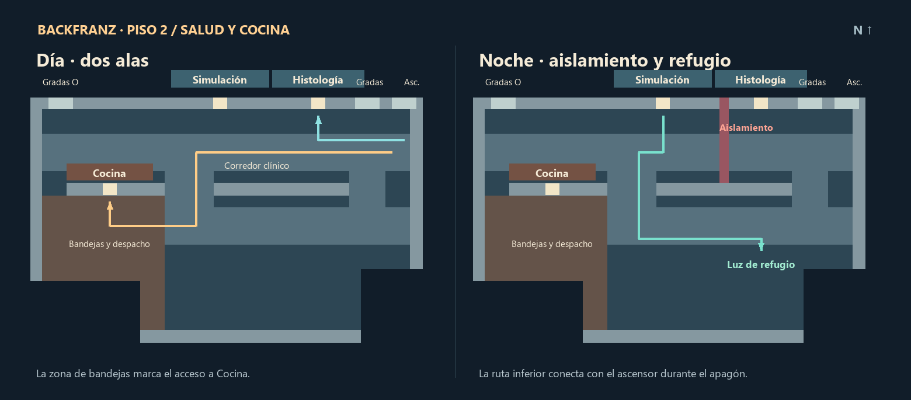

# Piso 2 · Salud y Cocina

La salida del ascensor da al corredor clínico. Simulación e Histología tienen acceso desde ese corredor. El cruce central baja a la zona de bandejas y al acceso de Cocina. Los dos extremos del ala clínica siguen conectados por el pasillo inferior, también cuando se cierra el paso directo durante el apagón.

| Ambiente | Distribución |
|---|---|
| Cocina de Prácticas | Dos islas de preparación al oeste, registro de bandejas y lavado al este. El paso central permite llevar las bandejas desde la entrada hasta los equipos. |
| Sala de Simulación | Dos puestos de camilla separados por un pasillo clínico. El armario del botiquín queda al fondo, del lado de la primera camilla. |
| Histología y Fisiología | Puestos de microscopio en hileras, con paso central y lavamanos al fondo. La estación de inducción conserva acceso desde el pasillo interior. |

Durante el apagón, Nuria espera junto a una camilla en Simulación. El botiquín se recoge del armario y aparece en la mochila hasta que se lo entregas. Cuando pueda caminar, acompáñala por el cruce central hasta la luz verde junto a la banca del pasillo inferior. Espera a que se acerque para usar la radio. El rescate se conserva al guardar y cuenta en la evacuación. En guardados anteriores, haber ayudado a Nuria en el Auditorio conserva su resultado.
