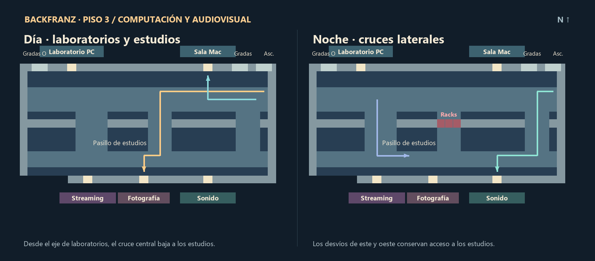

# Piso 3 · Computación y Audiovisual

El ascensor llega al corredor norte. El Laboratorio PC y la Sala Mac abren hacia ese eje. Streaming, Fotografía y Sonido comparten un pasillo al sur, con un cruce directo por el centro durante la inducción y dos conexiones laterales.

| Ambiente | Distribución |
|---|---|
| Laboratorio PC | Dos bloques de puestos con un pasillo central, una pizarra para prácticas y equipo de red al fondo. |
| Sala Mac | Puestos de edición junto al ventanal, mesa común y sector de espera. |
| Streaming | Consola y aviso de emisión al fondo, micrófono al este y una mesa auxiliar con la radio al oeste. |
| Fotografía | Fondo y zona de toma en la mitad superior. La mesa de equipo queda separada del espacio entre los trípodes. |
| Sonido | Cabina y consola de inducción durante el día. De noche, una consola de armado y tres filas de placas acústicas. |

En Backfranz, los racks obstruyen el cruce central. Se puede bajar al corredor de estudios por el este o el oeste. La grabadora de prácticas sigue en una mesa junto a Sonido y se puede recoger con la puerta cerrada. Sonido abre al sincronizar las estaciones de señal. Las pistas del puzzle siguen con Lina, Diego y Hugo en Streaming, Fotografía y Sala Mac.

La radio de mano se puede recoger en Streaming durante cualquiera de las dos fases. En su ficha de la mochila, **Escuchar** reproduce una transmisión con orientación. La prueba diurna de Lina confirma que funciona. Durante el apagón, el canal distingue entre la puerta sin señal, la búsqueda de las tres pistas y la validación del recorrido. La radio se conserva al guardar.
