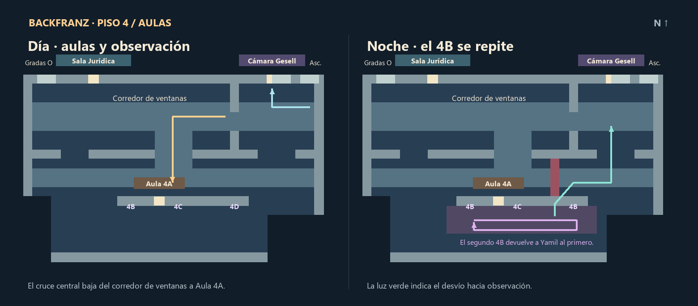

# Piso 4 · Aulas

Desde el ascensor se llega al acceso de Cámara Gesell. El corredor de ventanas comunica con la Sala Jurídica. El cruce central baja a Aula 4A y los cruces laterales conectan los dos extremos del piso.

| Ambiente | Distribución |
|---|---|
| Sala Jurídica | Mesa de audiencia al fondo, mesa de preparación al oeste y atril a la derecha. Los asientos dejan libre el eje hacia la entrada. |
| Cámara Gesell | Ventanal de observación al fondo, estación de registro y sillas de observación a la derecha. El extremo izquierdo tiene un espacio de espera. |
| Aula 4A | Dos bloques de mesas, pasillo central y registro de prácticas sobre el escritorio. La tiza blanca queda en la mesa auxiliar a la izquierda. |

Durante el apagón, las placas del tramo inferior dicen **4B, 4C, 4B**. Al pasar el segundo 4B en dirección este, Yamil regresa al primero y descubre una puerta lateral junto a la luz verde. Para salir por ahí, hay que volver a la luz antes de cruzar el segundo 4B y usar la puerta. El desvío conecta con el lado de observación. Los accesos habituales a las salas y a los objetivos de la campaña siguen transitables.

Con la tiza se puede marcar una cruz bajo el primer 4B y constatar el regreso al mismo punto. La repetición también se puede resolver usando las placas y la luz. La tiza aparece en Aula 4A en ambas fases hasta que la recoges. El guardado conserva la cruz, el desvío descubierto y la tiza.
