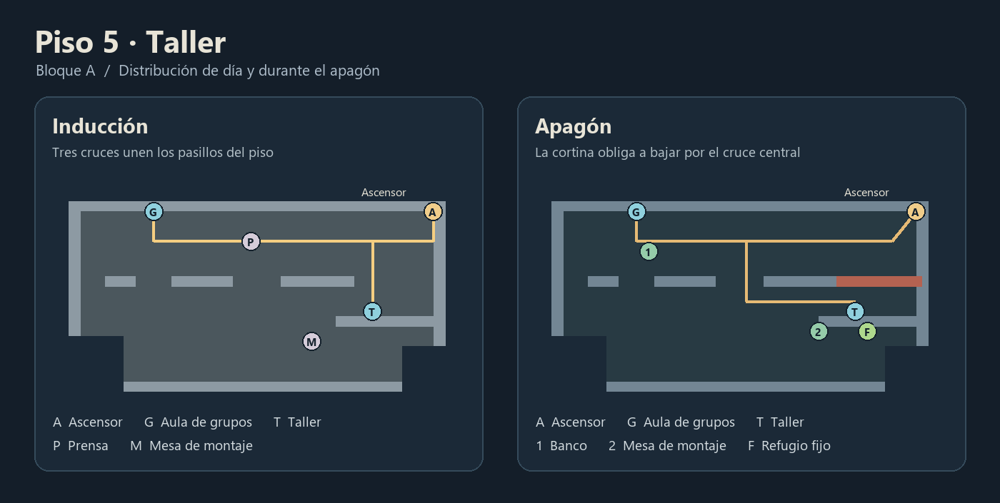

# Piso 5 · Taller

El ascensor desemboca por el este. El corredor principal lleva al Aula de grupos, al noroeste. Para entrar al Taller se baja al corredor inferior por el cruce central o por el paso este. Los bancos, el tablero de herramientas y los cambios de piso orientan el recorrido.

| Ambiente | Distribución |
|---|---|
| Aula de grupos | Bancas y mesa auxiliar a la izquierda, dos mesas de proyectos a la derecha y pizarra al fondo. El pasillo central conecta los grupos con la entrada. |
| Taller | Banco de herramientas y prensa a la izquierda, estante central y mesa de componentes a la derecha. La cuña está junto al banco y el cable queda junto a la mesa de componentes. |

Durante el apagón, la cortina metálica cierra el paso directo del este. El cruce central conecta con el corredor inferior y permite llegar al Taller y al refugio fijo de Elena. La prensa de la campaña queda en el pasillo principal.

La cuña y el cable se pueden recoger durante la inducción o durante el apagón. El cable puede alimentar la lámpara del banco junto al Aula de grupos o la lámpara de la mesa de montaje en el corredor inferior. Hay que desenchufarlo para trasladarlo. Cualquiera de esas luces encendidas sirve como refugio para Elena cuando ambos llegan al punto de reunión. El refugio fijo del este funciona desde el principio. La mochila indica dónde quedó conectado el cable y el guardado conserva ese estado.
