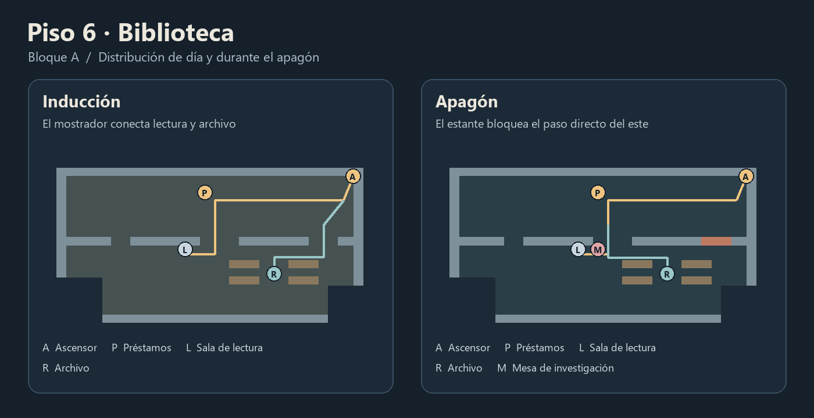

# Piso 6 · Biblioteca

El ascensor y las gradas desembocan en el vestíbulo de préstamos. El mostrador central sirve de referencia. Desde ahí se baja por el cruce central y se llega a la puerta de la Sala de lectura. El archivo queda al sureste y tiene un pasillo entre dos hileras de estantes.

| Ambiente | Distribución |
|---|---|
| Vestíbulo de préstamos | Mostrador, exhibidor de revistas y banca bajo el ventanal. Hay espacio libre entre el ascensor y el mostrador. |
| Sala de lectura | Mesas con lámparas y sillas junto al ventanal. Los estantes y el carro de libros ocupan el otro lado. El pasillo central queda libre para recorrer la sala y hablar con Alma. |
| Consulta y archivo | Una mesa auxiliar ocupa el centro y el archivo tiene su propio camino por el este durante la inducción. |

Durante el apagón un estante bloquea el paso directo del este. Se puede llegar al archivo por el cruce central. El Índice de evacuación permanece sobre el mostrador. La mesa donde se cotejan los testimonios tiene una lámpara cálida en el cruce central.

La figura se ve entre los estantes cuando Yamil vuelve al pasillo. Si se acerca por el archivo, la radio se corta y la figura desaparece. El efecto no bloquea puertas ni pasos. La escena que inicia el apagón se activa al bajar en ascensor después de terminar la inducción.
