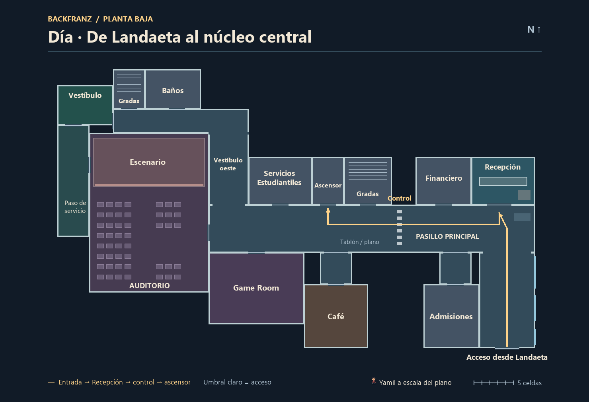
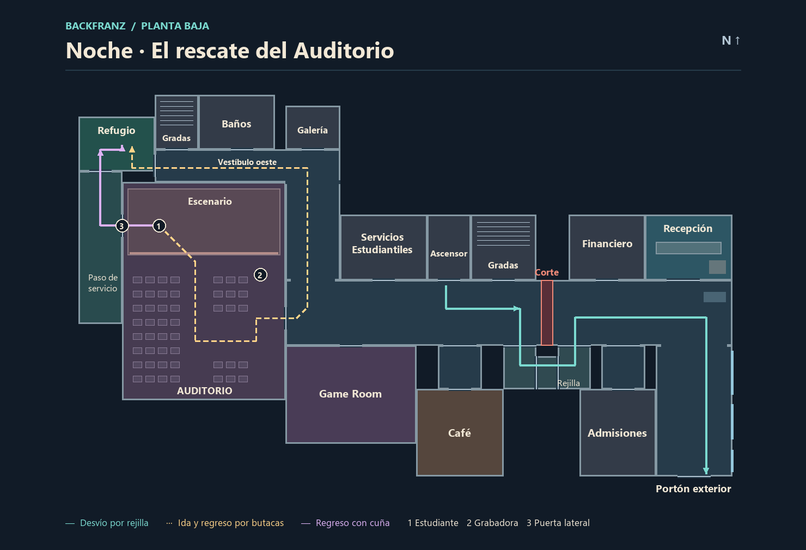

# Rediseño del Bloque A · Planos para revisión

La primera propuesta fija la llegada desde Landaeta, las conexiones de planta baja y el rescate del Auditorio. Los planos representan la distribución jugable. El levantamiento de la sede y las referencias de la calle están documentados en [Levantamiento La Paz](../../Campus/Levantamiento-La-Paz.md).

El primer tramo diurno está montado en Unity. Las coordenadas y accesos de esa implementación están en [Planta baja](../Planta-Baja.md) y en su [tabla de distribución](../Distribucion-Planta-Baja.csv).

La grabadora y la cuña se pueden recoger con **E** o con el botón táctil de interacción. La grabadora está en una mesa junto a la puerta de **Sonido, piso 3**, y la cuña está en una mesa dentro de **Taller, piso 5**. Ambas aparecen en la mochila, se conservan al continuar una partida y se pueden usar en el rescate nocturno del Auditorio.

## Levantamiento previo al rediseño

| Zona | Distribución actual comprobada en el código | Decisión para el rediseño |
|---|---|---|
| Landaeta | El acceso ya sube entre paredes y gira a la derecha. El pie de la escalera, el descanso y la puerta lateral están en `(10,10)`, `(10,14)` y `(14,14)`. El Instituto Americano queda enfrente. | Conservar el recorrido. Trabajar la pendiente, la unión de barandas y escalones, y el encuadre desde el que se descubre la puerta. |
| Planta baja | El tramo horizontal tiene seis celdas de fondo. Recepción es una ventanilla en `(54,17)`, el control está en la columna 39 y el vestíbulo entra desde `(58,2)`. Ascensor y gradas centrales son dos accesos separados. | Dar espacio propio a la fila de Recepción y orientar el vestíbulo para que se distingan el mostrador y el control. Conservar los interiores independientes y el retorno a su marco. |
| Extremo oeste | Gradas en `(5,20)`, baños en `(8,20)` y puerta del Auditorio en `(7,13)`. El Auditorio tiene asientos, tarima y una puerta de retorno. | Dar a los tres accesos un vestíbulo común, con las gradas a la izquierda de los baños. Añadir al Auditorio una segunda salida real por servicio. |
| Planta baja alterada | Una división corta el pasillo principal en la columna 38. La rejilla al sur vuelve a unir ambos lados del control. La Galería de servicio tiene su propio acceso y requisitos. | Mantener el desvío de rejilla como ruta principal. Dibujar el atajo del Auditorio en el extremo oeste para que nunca sirva de paso alrededor de la división ni de acceso temprano a la Galería. |
| Pisos 1–6 | P1 tiene una sala de espera quebrada. P2 usa corredores paralelos. P3 tiene un ramal de estudios. P4 separa los tramos de aulas y observación. P5 subdivide el fondo y la zona de Taller. P6 abre un eje central hacia lectura. La noche añade divisiones específicas. | Trabajar desde esa geometría, conservar la identidad de cada acceso y medir primero qué divisiones requieren cambios. |
| Subsuelo y Galería | El subsuelo se divide por una reja. El fusible y el cuadro permiten abrirla. La Galería tiene luces de refugio, testigos y mecanismos. | Mejorar la lectura de la energía y del camino entre las referencias existentes. |

Fuentes locales: [calle](../../../Assets/Scripts/Playable/World/CampusWorld.Street.cs), [planta baja](../../../Assets/Scripts/Playable/World/CampusWorld.Ground.cs), [pasillos y subsuelo](../../../Assets/Scripts/Playable/World/CampusWorld.cs), [interiores](../../../Assets/Scripts/Playable/World/CampusWorld.Rooms.cs), [desvíos nocturnos](../../../Assets/Scripts/Playable/World/CampusWorld.DarkHalls.cs) y [galería](../../../Assets/Scripts/Playable/World/CampusWorld.Gallery.cs).

## Planta baja de día

- Desde **Landaeta**, el jugador sale de las gradas junto a las tiendas, gira a la derecha y entra por el vidrio. El recorrido señalado en el plano empieza justo al traspasar ese acceso.
- **Recepción** queda al extremo este del pasillo, del lado de llegada al control. La espera va contra el vidrio. Una persona esperando frente al mostrador debe dejar un carril libre de circulación.
- El **núcleo central** reúne ascensor y gradas junto al tablón del plano de evacuación. El movimiento entre pisos y la fila del control quedan en espacios diferentes.
- **Financiero y Servicios Estudiantiles** dan al borde superior. **Game Room, Café y Admisiones** dan al borde inferior, con accesos cortos para Café y Admisiones. La separación entre puertas deja espacio para leer cada fachada antes de entrar.
- **Gradas oeste, baños y Auditorio** comparten el vestíbulo oeste. Desde el vestíbulo del Auditorio ya se ve el pasillo entre butacas y, desde el escenario, la salida lateral. El paso lateral señalizado es de servicio durante la inducción.

El tablero usa una cuadrícula de diseño. Probaría un pasillo principal de **6 celdas**, un ramal oeste de **5**, servicio de **3** y un pasillo central de butacas de **3**. Las puertas del plano muestran conexión y orientación. El tamaño del marco, la cámara y la claridad de los giros se comprobarán con Yamil en Unity. Los interiores seguirán cargando por separado, con la posición de retorno ligada a cada puerta.

## Planta baja de noche · Rescate del Auditorio

1. La división de los molinetes obliga a cruzar por la rejilla. Se conserva esa regla para llegar del ascensor a la entrada. El rescate sucede a la izquierda del control.
2. En el Auditorio, el ruido del altavoz enseña que la presencia gira hacia el sonido. El estudiante espera en el lateral del escenario. El jugador puede volver a salir y regresar para intentarlo de nuevo.
3. **Sin objetos**: entrar por el este, cruzar por el pasillo central, esperar una apertura y regresar con el estudiante por el mismo acceso. Luego subir por el vestíbulo oeste hasta el refugio.
4. **Con grabadora**: ponerla a reproducir junto a las butacas del este. Mientras la presencia se desplaza hacia el sonido, usar el costado opuesto para llegar al estudiante. El regreso por el acceso público sigue disponible.
5. **Con cuña**: entrar desde el vestíbulo público al corredor de servicio, preparar la puerta de retorno junto al escenario y volver a cruzarla con el estudiante. La puerta sin calzar se cierra antes de que el acompañante pueda cruzar, por lo que el trayecto público sigue siendo el camino de regreso.
6. El rescate se confirma cuando **ambos** llegan al refugio. La Galería de servicio de la campaña queda como acceso separado junto al vestíbulo oeste.

El primer pase debe comprobar que el acompañante conserva espacio para girar, que ambas salidas regresan al marco correcto, que el audio enseña la reacción de la presencia y que se puede repetir el rescate al fallar. La grabadora de Sonido y la cuña de Taller se podrán recoger tanto de día como de noche. La grabadora estará en el vestíbulo técnico de Sonido, antes de la puerta que protege el puzzle de las placas.

## Conexiones para el resto del atlas

| Piso | Día | Noche |
|---|---|---|
| 1 · Servicios | Ascensor → eje de atención → Caja, Posgrado y Dirección. | Persiana en un tramo intermedio. Los extremos siguen unidos por el rodeo. Sonido del relé como referencia. |
| 2 · Salud y cocina | Ascensor → cruce → Cocina hacia un ala y Simulación e Histología hacia la otra. | Iluminación sectorizada. Armario del botiquín en Simulación y recorrido del herido hacia una zona de espera iluminada. |
| 3 · Computación | Ascensor → cruce de PC y Mac → ramal audiovisual de Streaming, Fotografía y Sonido. | Radio en Streaming y grabadora en Sonido. Reservar un camino hasta Sonido que permita llegar a las placas por un acceso físico. |
| 4 · Aulas | Ascensor → corredor de ventanas → Aula 4A, Sala Jurídica y ramal interior de Gesell. | Tramo repetido con un desvío reconocible por numeración. La tiza de 4A permite marcar un punto antes del retorno. |
| 5 · Taller | Ascensor → pasillo largo → Aula de grupos y Taller. | Cortina metálica con acceso lateral. Cuña cerca de herramientas y cable que permite reubicar una lámpara. |
| 6 · Biblioteca | Ascensor → mostrador → cruce de estantes y Sala de lectura. | El mostrador sigue visible al llegar. Los estantes enmarcan una aparición; la mesa de investigación queda en un nicho tranquilo. |
| −1 · Mantenimiento | Eje del ascensor, equipo eléctrico, reja y zona de presión. | Llegada sin energía. Fusible → cuadro → luces → lecturas → regulador. La Galería mantiene su secuencia propia de refugios y mecanismos. |

## Reestructuración de cada piso y sala

El rediseño abarca PB, los pisos 1 a 6 y mantenimiento. Cada planta tendrá una distribución propia y se trabajará junto con todos sus interiores. La planta debe poder reconocerse por sus conexiones y su circulación, además de los materiales.

1. Dibujar el pasillo principal, los ramales del piso, los descansillos, los puntos de referencia y las conexiones con ascensor y gradas. Ubicar en el plano la puerta de cada ambiente y su retorno.
2. Dibujar el interior de **cada sala**, según lo que ocurre en ella. Decidir dónde se entra, cómo se llega al fondo, dónde se espera o trabaja y qué elementos ocupan cada lado. Dar a los ambientes grandes pasillos interiores propios, como las hileras de la biblioteca, las calles entre puestos de los laboratorios o el pasillo de butacas del Auditorio.
3. Montar primero muros, umbrales y colisiones a la escala de Yamil. Integrar puertas, marcos, señalética y mobiliario. Añadir rutas de NPC que dejen espacio junto a los accesos. Diferenciar las salas por luz, sonido, texturas, equipamiento y actividad.
4. Diseñar la variante nocturna del mismo piso y de sus interiores. Marcar qué accesos cambian, qué referencias siguen visibles y cómo se puede completar la ruta sin objetos opcionales. Ajustar los puzzles y diálogos a la distribución.
5. Probar un piso completo de día y de noche. Verificar ida y vuelta por cada puerta, rutas desde el ascensor y las gradas, recorridos con NPC, guardado y continuidad de objetivos. Entregar plano y capturas de cada sala para revisión.

El Auditorio nocturno, los pisos 1 a 6, Mantenimiento y la Galería de servicio tienen recorridos propios en el atlas.

Consulta el [mapa del piso 1 · Servicios](Piso-1-Servicios.md) para ver los corredores, las tres salas y el rodeo nocturno.

El [plano del piso 2 · Salud y Cocina](Piso-2-Salud-y-Cocina.md) muestra la conexión de las dos alas y la ruta hacia el refugio de Nuria.

El [plano del piso 3 · Computación y Audiovisual](Piso-3-Computacion.md) muestra los dos corredores, los accesos a los estudios y el rodeo nocturno.

El [plano del piso 4 · Aulas](Piso-4-Aulas.md) muestra el corredor de ventanas, Cámara Gesell y la salida del tramo que se repite.

El [plano del piso 5 · Taller](Piso-5-Taller.md) muestra Aula de grupos, el desvío de la cortina y los puntos de refugio para Elena.

El [plano del piso 6 · Biblioteca](Piso-6-Biblioteca.md) muestra el mostrador de préstamos, la Sala de lectura y el desvío al archivo durante el apagón.

El [plano del subsuelo y la Galería de servicio](Subsuelo-y-Galeria.md) muestra la ruta del fusible, la reja, el regulador y el circuito de refugios de la Galería.

## Para aprobar esta primera distribución

- Recepción al entrar, en el lado este y antes del control.
- Gradas a la izquierda de los baños y ambos accesos en el extremo oeste.
- Puerta pública del Auditorio al vestíbulo y puerta lateral del escenario al corredor de servicio. Las tres rutas del rescate terminan en el mismo refugio.

La revisión en Unity permite ajustar la circulación del Auditorio antes de trasladar su ramal de servicio a la noche. Los mapas detallados de los pisos superiores se prepararán a partir de las conexiones de la tabla.
