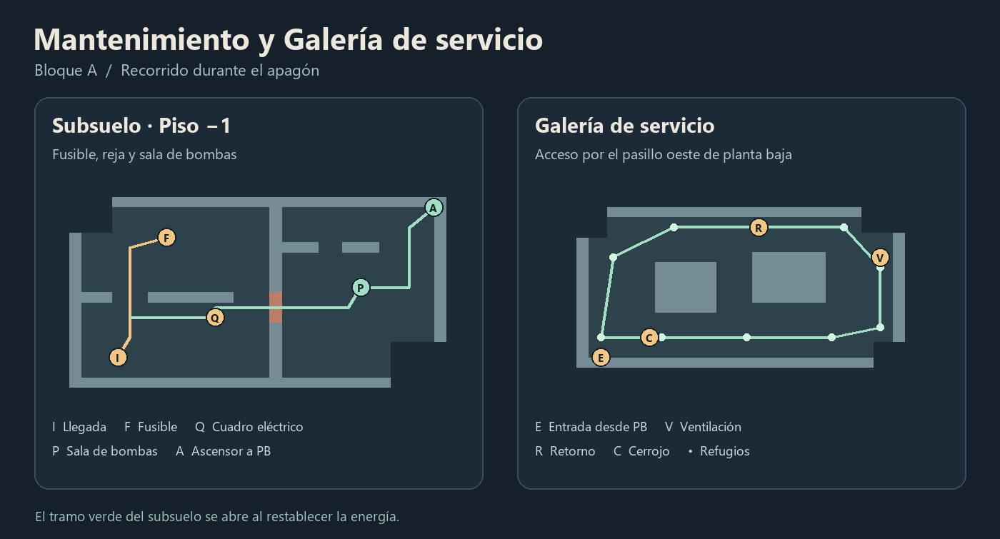

# Subsuelo y Galería de servicio

## Subsuelo de Mantenimiento

Yamil llega al lado oeste, con iluminación de emergencia parcial. El pasillo de metal comunica el manómetro de ingreso con el almacén de repuestos. El fusible queda sobre el banco del almacén. El cuadro eléctrico está de vuelta en el corredor inferior.

Al instalar el fusible se abre la reja en la división central y se encienden las luces de la reja, las bombas y el camino hacia el ascensor. Los tres medidores distinguen ingreso, retorno y purga. Su pantalla cambia de color al registrar la lectura. El regulador queda frente a las bombas y usa las lecturas anotadas en el diario.

## Galería de servicio

El acceso queda en el pasillo oeste de planta baja, junto al Auditorio. Se llega desde Mantenimiento por el ascensor a PB. El testigo de la puerta indica cuándo el archivo de cámaras y el canal de Sonido habilitan el paso.

La Galería rodea dos islas de maquinaria. Las franjas verdes permiten recuperar el aliento antes de pasar al siguiente tramo. Mara queda cerca de la entrada, Felipe junto a la ventilación y Celia en la pasarela superior. La ventilación, el medidor de retorno y el cerrojo tienen equipos distintos. Si la sombra alcanza a Yamil, lo devuelve a la última franja y conserva el avance.

El cerrojo queda junto a la misma puerta por donde se entra. Al liberarlo, esa puerta devuelve a Yamil al pasillo oeste para reunirse con el equipo. El guardado conserva las lecturas y la calibración del subsuelo, además de los mecanismos accionados en la Galería.
