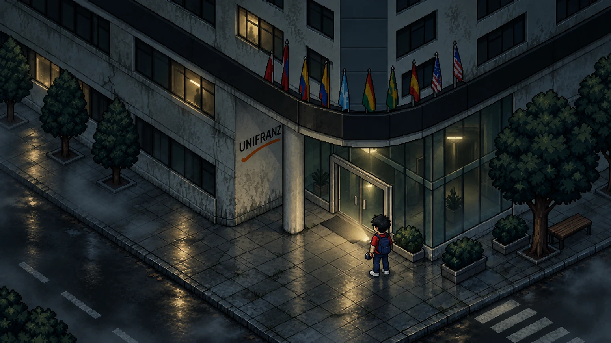

# Backfranz

[](https://alexwuuu1.github.io/backfranz/)

**[Landing y galería](https://alexwuuu1.github.io/backfranz/)** · **[Guía de código y defensa](Docs/Backfranz-Guia-de-codigo-y-defensa.pdf)** · **[Atlas del Bloque A](Docs/BloqueA/Rediseno/README.md)**

Backfranz es un juego 2D de exploración y terror universitario del **Grupo 64**. Yamil llega a su primer día de inducción en Unifranz La Paz. Un descenso en ascensor lo lleva a una versión alterada del Bloque A, donde deberá investigar, ayudar a otros estudiantes y resolver los mecanismos de evacuación.

**Motor** · Unity 6000.3.16f1, Unity 6.3 LTS.

**Versión integrada** · `main`. **Integración del equipo** · `develop`.

## Avance presentado

- Introducción mediante diálogos que presentan a Yamil, la universidad y el objetivo de su visita.
- Tutorial de cuatro pasos con desplazamiento, interacción, pausa y llegada a Recepción. Incluye indicaciones para teclado y móvil y la opción de omitirlo.
- Exterior, recepción y control de acceso, siete plantas del campus, interiores independientes, dos escaleras y ascensor.
- Actividades de inducción y transición a Backfranz, con investigación, pistas, puzzles, rescates y tres finales.
- Diario, guardado local, continuación de partida, pausa, opciones, galería y créditos.
- Mochila con descripciones, objetos útiles para el apagón y pensamientos de Yamil consultables durante el recorrido.
- Distribuciones propias para el exterior, planta baja, los seis pisos, Mantenimiento y la Galería de servicio.
- Pixel art con fuentes editables ASE, exportaciones PNG, tipografía Backfranz Pixel y audio ambiental.

La distribución de los ambientes es una adaptación para el videojuego. El recorrido, los mecanismos y el alcance actual se describen en la documentación del Bloque A. [Recorrido y alcance](Docs/BloqueA/README.md) · [Campaña de escape](Docs/BloqueA/Escape.md)

## Equipo

| Integrante | Cuenta de GitHub |
|---|---|
| Alejandro Villalpando Rojas | [Alexwuuu1](https://github.com/Alexwuuu1) |
| Cristopher Iori Lazcano Gutierrez | [Crisshubb](https://github.com/Crisshubb) |
| Galilea Alison Llusco Asistiri | [Galileya](https://github.com/Galileya) |
| Alex Joel Quispe Ticona | [lpzealexjoelquispeti-dot](https://github.com/lpzealexjoelquispeti-dot) |

## Ejecutar el proyecto en Unity

1. Clonar el repositorio y seleccionar `main`.

   ```bash
   git clone --branch main https://github.com/Alexwuuu1/backfranz.git
   ```

2. Añadir la carpeta a Unity Hub y abrirla con **6000.3.16f1**. La primera apertura descarga los paquetes y regenera la caché.
3. Abrir `Assets/Scenes/MenuPrincipal.unity`, pulsar Play y elegir **Nueva partida**.
4. Para recuperar un guardado de este equipo, elegir **Continuar partida**.

| Acción | Teclado | Android |
|---|---|---|
| Moverse | WASD o flechas | Cruceta táctil |
| Correr | Shift izquierdo | — |
| Interactuar | E o Espacio | Botón de la mano |
| Avanzar un diálogo | E, Espacio o Enter | Botón del diálogo |
| Consultar misión | M o botón Misión | Botón Misión |
| Abrir la mochila | I o botón Mochila | Botón Mochila |
| Pausar y acceder al guardado | Escape | Botón de pausa |

## Windows y Android

Los ejecutables de esta revisión se generan desde Unity. Los enlaces de descarga se incorporarán cuando el equipo los suba a Google Drive.

| Entregable | Estado de la revisión |
|---|---|
| Windows x64 | Compilación y prueba del ejecutable pendientes de registrar |
| Android APK | Compilación y prueba en dispositivo o emulador pendientes de registrar |
| Enlaces de Google Drive | Pendientes de proporcionar por el equipo |

Para Windows, usar `Tools → Backfranz → Exportar → Windows x64`. El exportador genera `../Builds/Backfranz-Jugable/Backfranz.exe` respecto a la raíz del proyecto. Distribuir en ZIP la carpeta completa, incluidos `Backfranz_Data`, `UnityPlayer.dll` y los demás archivos generados.

Para Android, instalar **Android Build Support**, **Android SDK & NDK Tools** y **OpenJDK** para esta versión de Unity. Usar `Tools → Backfranz → Exportar → Android APK`. La salida es `../Builds/Android/Backfranz.apk`, con orientación horizontal y Android 8.0/API 26 como mínimo. Ambas exportaciones incluyen `MenuPrincipal` y `Nivel01`.

El estado y los datos que deben acompañar la entrega se registran en el documento de evaluación. [Entrega de la evaluación procesual](Docs/Evaluacion-Procesual.md)

## Verificaciones

La revisión del 26 de noviembre de 2026 completó **1.699 comprobaciones** del recorrido en Unity 6000.3.16f1 e incluyó inducción, transición al apagón, objetos, rescates, guardado y los tres finales. El verificador gráfico cotejó **951 fuentes ASE y 1.519 fotogramas PNG**. Las pruebas de ejecutables corresponden a la fase de exportación. [Registro histórico de integración](Docs/BloqueA/VERIFICACION-INTEGRACION.txt)

## Organización del repositorio

| Carpeta | Contenido |
|---|---|
| `Assets/Scenes` | Menú principal y escena que aloja la partida |
| `Assets/Scripts/Playable` | Controles, construcción de mapas, diálogos, inducción, puzzles y guardado |
| `Assets/Scripts/UI` | Menús, opciones, audio y navegación |
| `Assets/Resources/Backfranz` | Sprites, clips, mezclador y configuración cargados durante la partida |
| `Assets/Editor` | Exportadores y verificadores de Unity |
| `SourceAssets` | Fuentes ASE, generadores, manifiestos y atribuciones |
| `Docs/BloqueA` | Recorrido, campaña y verificaciones actuales |
| `Docs/Hito3` y `Docs/Hito4` | Documentación y evidencias de entregas anteriores |
| `site` | Código de la landing, ilustraciones y capturas optimizadas para la web |

Las ramas `feature/hito3-alejandro`, `feature/hito3-cristopher`, `feature/hito3-galilea` y `feature/hito3-alexjoel` conservan los aportes individuales y su historial. `main` contiene la revisión jugable. Las carpetas generadas por Unity y los ejecutables se excluyen mediante `.gitignore`.

### Vista previa y publicación de la landing

Desde la raíz, ejecuta `python -m http.server 8871 --directory site` y abre [la vista previa local](http://localhost:8871/). GitHub Pages sirve la rama `gh-pages`. Después de confirmar los cambios de `site` en `main`, sincroniza la landing con `git subtree push --prefix=site origin gh-pages`.

## Créditos y procedencia

Backfranz continúa el proyecto del Grupo 64 conservado en este repositorio y su historial de contribuciones. Las referencias de menú y las fuentes ASE históricas aportadas por el equipo se mantienen en `SourceAssets/Referencias` y `SourceAssets/Aseprite`.

El audio utiliza recursos de **Kenney, TinyWorlds, Thimras, rubberduck, PagDev, sinny, BMacZero, Independent.nu, Joseph Sardin, LEGIT Audio y Kresiek The Furry**, además de diseño sonoro propio. Los recursos externos, sus usos y licencias se identifican en los créditos. [Créditos y fuentes](CREDITOS.md) · [Fuentes y receta del audio](SourceAssets/Backfranz/AUDIO.md)

Los fondos y el logotipo se adaptaron con generación de imágenes asistida por IA. Los sprites generados, la tipografía y sus fuentes editables se documentan junto al arte. [Fuentes gráficas](SourceAssets/Backfranz/README.md) · [Registro visual del Hito 3](Docs/Hito3/ARTE.md)
